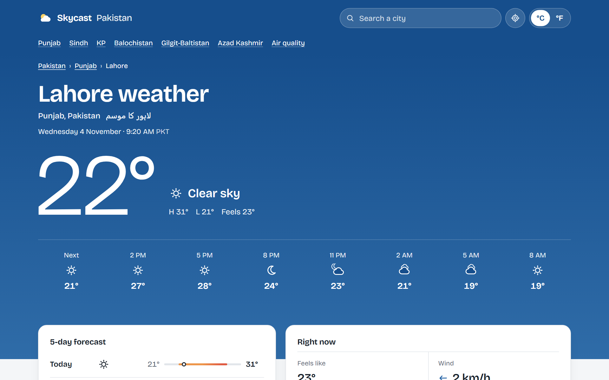
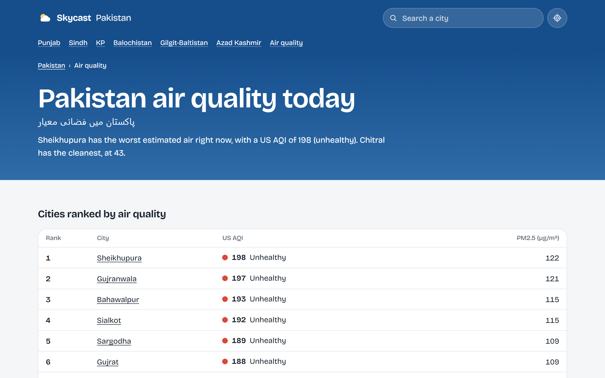

# Skycast: Pakistan weather

[](https://github.com/Shahryartariq/skycast/actions/workflows/ci.yml)

**[Live site: getskycast.vercel.app](https://getskycast.vercel.app)**

A fast, free, ad-free weather site for Pakistan. It covers 50 cities, hill stations and valleys with live conditions, 5-day forecasts, air quality and ten years of climate data. The colour of the page follows the real sky: blue on a clear afternoon, warm at sunrise and sunset, dark at night, grey in the rain.

<p align="center">
  
  &nbsp;
  
</p>

| Lighthouse | Performance | Accessibility | Best practices | SEO |
|---|---|---|---|---|
| Mobile | 96–98 | 100 | 100 | 100 |
| Desktop | 100 | 100 | 100 | 100 |

Measured on the home, city, province and air quality pages of a local production build, with no layout shift on any of them.

## Why Pakistan

"Weather" on its own is a search term nobody new can win. The big global sites own it. So Skycast picks a niche and serves it better than a global site can:

- **Local knowledge.** A note on what makes each place's weather different: Lahore's smog, Karachi's sea breeze, why Gilgit is so dry, when the road to Naran closes.
- **Places global sites treat as an afterthought,** such as Skardu, Hunza, Ziarat, Mithi and the Neelum Valley.
- **Local search behaviour.** Search works in Urdu (`لاہور`), and with the names people really use: Pindi, DG Khan, Mingora, Lyallpur. "Hyderabad" means Sindh, not India.
- **The numbers people compare.** Air quality is shown as a US AQI figure during smog season, not a generic 1-to-5 scale.

## Features

- **National overview**: the hottest and coldest places, where it's raining, and the worst air right now, plus a map of all 50 cities coloured by temperature.
- **50 city pages** with the next 24 hours, a 5-day forecast, wind, humidity, sunrise and sunset, and AQI.
- **Climate tables** for every city: monthly highs, lows and rain, the most comfortable months and the wettest.
- **Six province pages** and a **live air quality ranking** of every city, with health guidance for each level.
- **Questions answered from live data**, like "Will it rain in Lahore this week?"
- **Search anywhere in the world**, with keyboard-friendly suggestions. Recent places are remembered on your device.
- **Weather at my location, no typing**: [/my-location](https://getskycast.vercel.app/my-location) shows your IP address, your approximate place and its forecast, with no permission prompt. One tap switches to your exact location instead.
- °C or °F, and times in the place's own time zone.
- **Dark mode**: follows your device by default, or pick light or dark. The choice is remembered, with no flash on load, and open tabs stay in step.
- **Works without JavaScript**: pages render on the server, search falls back to a normal form, and the theme follows your device.
- **Installable** on a phone's home screen.

<p align="center">
  
  &nbsp;
  
</p>

## Tech stack

| Area | Choice |
|---|---|
| Framework | [Next.js 16](https://nextjs.org) (App Router, Server Components, Route Handlers, Proxy) |
| Language | TypeScript (strict) |
| UI | React 19, hand-written CSS, SVG icons and charts drawn for this app, no UI or chart libraries |
| Font | Bricolage Grotesque, self-hosted through `next/font` |
| Live data | [OpenWeather](https://openweathermap.org/api) current weather, 5-day forecast, air pollution and geocoding APIs (free plan) |
| Climate data | ERA5 reanalysis through [Open-Meteo](https://open-meteo.com/), built into a static file by a script |
| Tests | Vitest (75 unit and API tests), Playwright (130 end-to-end runs on desktop and mobile), axe-core accessibility checks in both themes |
| CI | GitHub Actions: lint, type check, unit tests, build, end-to-end tests |
| Hosting | Vercel |

## How it works

```
Browser ──▶ Next.js on Vercel ──▶ OpenWeather (live, cached)
            ├─ /                     national overview; lookups with ?q= or ?lat=&lon=
            ├─ /weather/[city]       50 city pages
            ├─ /pakistan/[province]  6 province pages
            ├─ /air-quality          live ranking
            ├─ /about                sources and limits
            └─ /api/places           suggestions for the search box

scripts/build-climate.ts ──▶ Open-Meteo ──▶ src/lib/data/climate.json (committed)
```

- **The API key stays on the server.** The browser only talks to this app, so the key never appears in the HTML, the JavaScript bundle or network requests.
- **Each kind of data is cached for as long as it stays true**: current weather for 10 minutes, the forecast for 30 (it comes in 3-hour steps), air quality for an hour (it's an hourly model), place lookups for a week. With all 50 cities kept warm that's about 7.5 calls a minute, roughly a third of the free plan's monthly allowance.
- **Pages share their requests.** A city's reading on the home page, its province page and its own page is one cached call.
- **Failure is contained.** A rate limit or dropped connection gets one retry. If a city still fails, it keeps its card and link but loses the number, so one bad reading never takes down a page. An error page is marked `noindex`, so it can't replace a good page in search results.
- **Climate data is built once, not fetched at runtime.** A script reduces 10 years of daily data per city to 12 monthly rows. The app makes no calls for it and has no dependency on that service.
- **The raw API data becomes one typed `Snapshot`** in `src/lib/forecast.ts`. That code is pure functions with unit tests.

## Decisions worth a look

**Hiding data that's wrong.** ERA5 is a model on a coarse grid, and in deep valleys it blends in the surrounding peaks. It gave Gilgit about 1,400 mm of rain a year, while weather stations in Gilgit-Baltistan measure roughly 150 to 500 mm. I compared every city against what's known, then hid rainfall for the 10 places where it can't be trusted and said why on the page. Tests make sure those figures can't reappear in the generated questions either.

**A canonical URL bug you can't see.** Vercel's `VERCEL_PROJECT_PRODUCTION_URL` resolved to an auto-generated alias that returned 404, so every canonical link and the sitemap told Google the real pages lived at a dead address. Everything looked fine in a browser. The domain is now set explicitly, and tests pin it.

**A map without a map library.** A script turns Natural Earth's boundaries into two SVG paths and checks all 50 cities against them. Each city is then a dot at its real coordinates, coloured by temperature, so the page loads no mapping code or tiles. Jammu and Kashmir is drawn as disputed territory, following Pakistan's official map.

**A strict CSP has a cost.** Nonces need every page to render per request, because a prerendered page can't carry one. Two new pages were silently prerendered, which would have blocked all their scripts in production, so there's now a test that checks the nonce on every page type. Weather pages are dynamic anyway, and the data behind them is cached, so the trade is cheap here.

**Dark mode without a flash or an inline script.** The usual approach keeps the choice in `localStorage` and runs an inline script before first paint, which a strict CSP has to make room for. Pages here already render per request, so the server reads a cookie and sends the right theme in the HTML. The first frame is correct, and the CSP didn't change. "System" stores nothing and leaves it to CSS, so that path needs no JavaScript at all.

**Prefetching that cost more than it saved.** Next.js prefetches every link on screen. With over 100 links on a page and no static routes to warm, that meant 30 to 45 background requests per page view, each one a function call, and real clicks queued behind them. Flaky end-to-end tests exposed it: a measurement showed the cause, and turning prefetching off fixed both the tests and the waste.

**"My location" without a lookup service or a prompt.** Vercel's edge already looks up every visitor's IP and adds the city and coordinates as request headers (overwriting anything the browser sends), so `/my-location` reads them on the server and needs no third-party IP API, no API key and no browser permission. Only coordinates rounded to about 1 km reach OpenWeather. The page is per visitor, so it's sent with `Cache-Control: private, no-store`. IP locations can be tens of kilometres off, and some Pakistani mobile networks route through Islamabad or Karachi, so the page says so and offers the exact location one tap away.

**No FAQ schema, on purpose.** Google stopped showing FAQ rich results in May 2026, so the questions are plain visible content for readers rather than markup that does nothing.

## SEO

- Titles and descriptions built around what people search for, with live conditions and the Urdu phrase in each city's description.
- Real written content on every city page, to avoid thin, templated pages.
- A clear hierarchy: home → province → city, with visible breadcrumbs, and links to nearby cities based on real distance. Every city is one click from the home page.
- Structured data: `WebSite`, `WebApplication`, `WebPage` with `City` and `GeoCoordinates`, and `BreadcrumbList`.
- `sitemap.xml` lists all 60 indexable pages. Search lookups, the °F view and preview deployments stay out of the index.
- Open Graph and Twitter cards with a generated image for every city and province.
- Unknown addresses return a real `404`, and old URLs redirect.

## Security and accessibility

- A strict Content Security Policy with a fresh nonce on every request (`src/proxy.ts`, `src/lib/csp.ts`), plus `X-Frame-Options`, `Referrer-Policy`, HSTS and a `Permissions-Policy` that allows only geolocation.
- Google Analytics is opt-in through `GA_MEASUREMENT_ID` and loads under the same nonce-based policy. Locations from "Use my exact location" are rounded to about 1 km before they go into the URL. The IP address on `/my-location` is shown only to its owner and never stored, logged by the app or sent to analytics.
- Input to `/api/places` is validated, and errors never echo the upstream URL (which holds the key).
- Landmarks, a skip link, a fully keyboard-operable search combobox, visible focus, text contrast of at least 4.5:1 on every sky colour, and support for reduced motion. End-to-end tests run axe-core on every page type and fail on any serious WCAG 2.1 AA issue.

## Known limits

- Skycast isn't a warning service. For floods and heat waves, follow the [Pakistan Meteorological Department](https://www.pmd.gov.pk/) and [NDMA](https://www.ndma.gov.pk/).
- AQI figures are estimates from a global model, not local monitors, so they can differ from sites that use sensors.
- Mountain forecasts and climate averages are less accurate than those for the plains. Averages can run several degrees cool in deep valleys.
- The free OpenWeather plan allows 60 calls a minute, and a fully cold cache needs more than that. Readings that miss out fill in on later requests. `/api/places` and `?lat=` lookups can spend quota too, so a busier site should add a rate-limit rule in the Vercel Firewall.
- `/my-location` relies on Vercel's IP headers. Run anywhere else (including `npm run dev`), it shows "We couldn't tell where you are" and offers the exact location instead.
- The interface is in English, with Urdu names and search. Full Urdu pages are the natural next step.

## Run it locally

You need Node.js 20.9 or newer.

```bash
npm install
cp .env.example .env.local      # then paste your key into .env.local
npm run dev                     # http://localhost:3000
```

Get a free API key at [openweathermap.org](https://home.openweathermap.org/api_keys). New keys can take up to two hours to start working.

No key yet? Run with the built-in sample data instead:

```bash
WEATHER_SAMPLE_DATA=1 npm run dev
```

### Environment variables

| Name | Required | What it does |
|---|---|---|
| `OPENWEATHER_API_KEY` | Yes | Your OpenWeather key. Server-side only. |
| `SITE_URL` | No | Public address for canonical links and the sitemap. Defaults to `https://getskycast.vercel.app` on Vercel and `http://localhost:3000` elsewhere. |
| `GOOGLE_SITE_VERIFICATION` | No | The code from Google Search Console's HTML tag method. |
| `GA_MEASUREMENT_ID` | No | Google Analytics 4 measurement ID (`G-…`). When set, the Google tag loads with the page's CSP nonce and the policy allows Google's analytics hosts; when unset, nothing from Google loads. |
| `WEATHER_SAMPLE_DATA` | No | Set to `1` to use the sample data in `src/lib/fixtures`. Ignored in Vercel production. |

## Scripts

| Command | What it does |
|---|---|
| `npm run dev` | Start the development server |
| `npm run build` / `npm start` | Build and run the production server |
| `npm run lint` | ESLint |
| `npm run typecheck` | Generate route types and run the TypeScript compiler |
| `npm test` | Unit and API route tests (Vitest) |
| `npm run test:e2e` | End-to-end and accessibility tests with Playwright, against the production build and sample data |
| `npm run climate` | Rebuild the climate data from Open-Meteo. Needs Node.js 22.18 or newer; run it about once a year. |
| `npm run map` | Rebuild the map outline from Natural Earth. Needs Node.js 22.18 or newer. |

Before running `npm run test:e2e` the first time, install the browser with `npx playwright install chromium`.

## Project structure

```
src/
  app/
    page.tsx                 National overview, and lookups for anywhere else
    weather/[city]/          City pages and their social images
    pakistan/[province]/     Province pages and their social images
    air-quality/, about/     Air quality ranking; sources and limits
    api/places/route.ts      City search for the search box
    sitemap.ts, robots.ts, manifest.ts, opengraph-image.tsx, apple-icon.tsx, pwa-icon/
    layout.tsx, error.tsx, not-found.tsx, globals.css
  components/                Page shell, national view, map, forecasts, climate, search, theme, icons
  lib/
    cities.ts                The 50 places: coordinates, Urdu names, aliases, search
    guides.ts                Hand-written notes on each place
    climate.ts, data/        Monthly climate data and summaries
    faq.ts                   Questions answered from live data
    seo.ts                   Page metadata and structured data
    csp.ts, analytics.ts     Security policy; optional Google Analytics
    theme.ts                 Theme names and the cookie that remembers the choice
    openweather.ts           Server-only API client (key, caching, retries, sample data)
    load.ts                  Loading and error handling shared by the pages
    forecast.ts              Raw API data → Snapshot
    conditions.ts            Weather codes, labels and sky colours
    format.ts, time.ts       Units, US AQI, conversions and time zones
    query.ts, site.ts        URLs and the canonical address
  proxy.ts                   Content Security Policy with nonces; 404s and redirects
scripts/                     Builds climate data and the map outline; checks coordinates against a geocoder
e2e/                         Playwright tests
```

## History

This project started in 2021 as a small Create React App exercise. In 2026 it was rebuilt from scratch with Next.js and TypeScript, then refocused from "weather for any city" to Pakistan.

## Credits

Live weather from [OpenWeather](https://openweathermap.org/). Climate data from [Open-Meteo](https://open-meteo.com/) under [CC BY 4.0](https://creativecommons.org/licenses/by/4.0/), based on ERA5 from the Copernicus Climate Change Service. Map outline from [Natural Earth](https://www.naturalearthdata.com/) (public domain). Built by [Muhammad Shehryar](https://github.com/Shahryartariq).

## License

[MIT](LICENSE)
