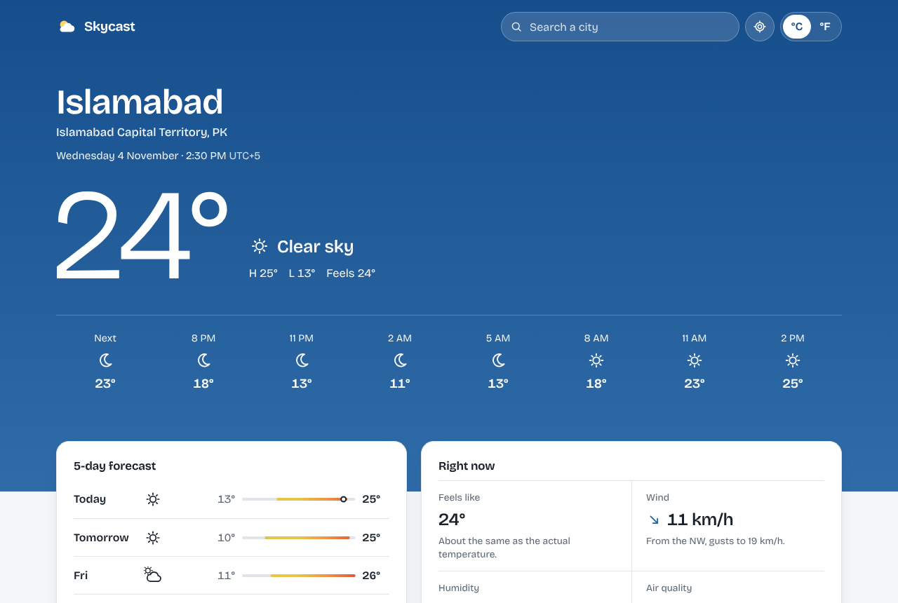
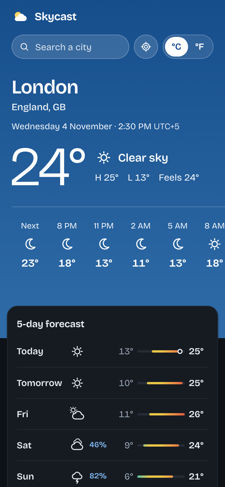

# Skycast

A weather app that shows the current conditions, the next 24 hours and a 5-day forecast for any city. The colour of the page follows the real sky: blue on a clear afternoon, warm at sunrise and sunset, dark at night, grey in the rain.

<p align="center">
  
  &nbsp;
  
</p>

## Features

- **Search any city** with suggestions as you type. Use the arrow keys and Enter, or the mouse. Recent places are remembered on your device.
- **Use my location** to get the weather where you are, after you allow it in the browser.
- **°C or °F**, with wind in km/h or mph and visibility in kilometres or miles. Your choice is kept in the URL, so links share the same view.
- **Next 24 hours** in 3-hour steps, with the chance of rain when it matters.
- **5-day forecast** with temperature bars on one shared scale, so warmer days are easy to spot.
- **Details**: feels-like temperature, wind direction and gusts, humidity with dew point, air quality (PM2.5), pressure, visibility, and a sunrise-to-sunset arc showing where the sun is now.
- **Times in the city's own time zone**, not yours.
- **Shareable links** such as `/?q=Lahore` or `/?lat=51.507&lon=-0.128&units=imperial`.
- **Works without JavaScript**: the page renders on the server and search falls back to a normal form.

## Tech stack

| Area | Choice |
|---|---|
| Framework | [Next.js 16](https://nextjs.org) (App Router, Server Components, Route Handlers) |
| Language | TypeScript (strict) |
| UI | React 19, hand-written CSS, SVG icons drawn for this app |
| Font | Bricolage Grotesque, self-hosted from npm |
| Data | [OpenWeather](https://openweathermap.org/api) current weather, 5-day forecast, air pollution and geocoding APIs (free plan) |
| Tests | Vitest (unit and API route), Playwright (end-to-end on desktop and mobile) |
| CI | GitHub Actions: lint, type check, unit tests, build, end-to-end tests |
| Hosting | Vercel |

## How it works

```
Browser ──▶ Next.js on Vercel ──▶ OpenWeather
            ├─ page (Server Component): fetches weather for the place in the URL
            └─ /api/places: city suggestions for the search box
```

- **The API key stays on the server.** The browser only talks to this app. The page and `/api/places` call OpenWeather from the server with `OPENWEATHER_API_KEY`, so the key never appears in the page, the JavaScript bundle or network requests.
- **Responses are cached.** Weather is cached for 10 minutes and place lookups for a week, which keeps the app fast and well inside the free plan's limits.
- **The raw data is turned into one typed `Snapshot`** in `src/lib/forecast.ts`. That code is pure functions with unit tests: each day is described by its midday weather, today's range includes the current reading, and nearly empty trailing days are dropped.
- **Security headers**: a strict Content Security Policy with a fresh nonce per request (`src/proxy.ts`), plus `X-Frame-Options`, `Referrer-Policy`, HSTS and a `Permissions-Policy` that allows only geolocation.

## Run it locally

You need Node.js 20.9 or newer.

```bash
npm install
cp .env.example .env.local      # then paste your key into .env.local
npm run dev                     # http://localhost:3000
```

Get a free API key at [openweathermap.org](https://home.openweathermap.org/api_keys). New keys can take up to two hours to start working.

No key yet? Run with the built-in sample data instead:

```bash
WEATHER_SAMPLE_DATA=1 npm run dev
```

### Environment variables

| Name | Required | What it does |
|---|---|---|
| `OPENWEATHER_API_KEY` | Yes | Your OpenWeather key. Server-side only. |
| `WEATHER_SAMPLE_DATA` | No | Set to `1` to use the sample data in `src/lib/fixtures`. Ignored in Vercel production. |

## Scripts

| Command | What it does |
|---|---|
| `npm run dev` | Start the development server |
| `npm run build` / `npm start` | Build and run the production server |
| `npm run lint` | ESLint |
| `npm run typecheck` | Generate route types and run the TypeScript compiler |
| `npm test` | Unit and API route tests (Vitest) |
| `npm run test:e2e` | End-to-end tests with Playwright, against the production build and sample data |

Before running `npm run test:e2e` the first time, install the browser with `npx playwright install chromium`.

## Deploy to Vercel

1. Import this repository in Vercel. It detects Next.js; no settings to change.
2. Add `OPENWEATHER_API_KEY` under **Settings → Environment Variables** for Production and Preview.
3. Deploy. Every push to `main` deploys again.

## Project structure

```
src/
  app/
    page.tsx            The weather page (Server Component)
    api/places/route.ts City search for the search box
    layout.tsx, loading.tsx, error.tsx, globals.css
  components/           Hero, hourly and daily forecasts, details, search, location and unit controls, icons
  lib/
    openweather.ts      Server-only API client (key, caching, sample data)
    forecast.ts         Raw API data → Snapshot
    conditions.ts       Weather codes, labels and sky colours
    format.ts, time.ts  Units, conversions and time zones
    query.ts            Reading and writing the URL
  proxy.ts              Content Security Policy with nonces
e2e/                    Playwright tests
```

## History

This project started in 2021 as a small Create React App exercise. In 2026 it was rebuilt from scratch with Next.js and TypeScript, with the API key moved to the server.

## Credits

Weather data from [OpenWeather](https://openweathermap.org/). Built by [Muhammad Shehryar](https://github.com/Shahryartariq).

## License

[MIT](LICENSE)
